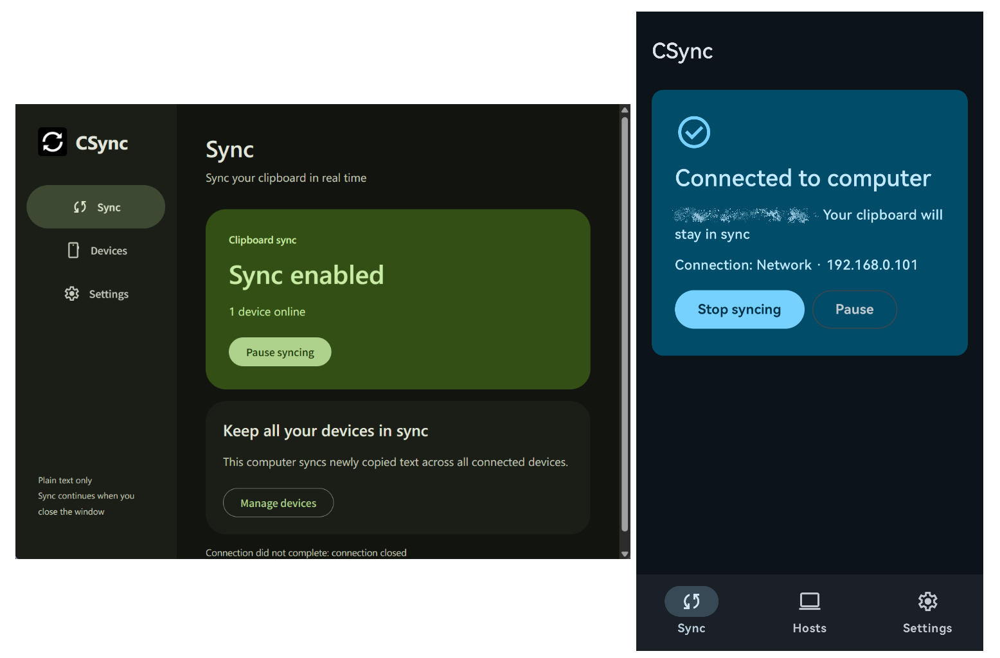

# CSync - A tiny tool with only one function

This software has only one function: Synchronize your clipboard in real time between Windows and Android devices.

No other function; As fast as lightning; only 5MB in total!

The clipboard can sync even when running in the background, without requiring any user action.

# Requirements

- Windows: Windows 11

- Android: Android 12 or above

- In Android, you should install [Shizuku](https://github.com/RikkaApps/Shizuku/releases) and start it. [Why?](#why-is-shizuku-needed)

- Your phone and computer must be on the same local area network.

# Features

- Extremely low resource usage, powered by Rust and Kotlin

| resource usage | Windows  | Android  |
|-|-|-|
| RAM usage | about 5MB | about 60MB |
| Disk usage | about 3MB | about 5MB |

- Quickly pair and connect: Connect to the same LAN and scan the QR code to pair.

- Real background sync: Synchronize your clipboard immediately, even CSync in background

- Clear and beautiful UI: Material 3 Design

# What I’d like to say

CSync is still under active development. Although it is not yet perfect, I will continue to do my best to develop it.

Thanks to ChatGPT for the help. Without it, I wouldn't have been able to complete CSync.

# Why is Shizuku needed

Starting with Android 10, apps are unable to read the clipboard while running in the background. Shizuku grants this app the necessary privileges to read the clipboard while in the background, without requiring any further action from the user.
