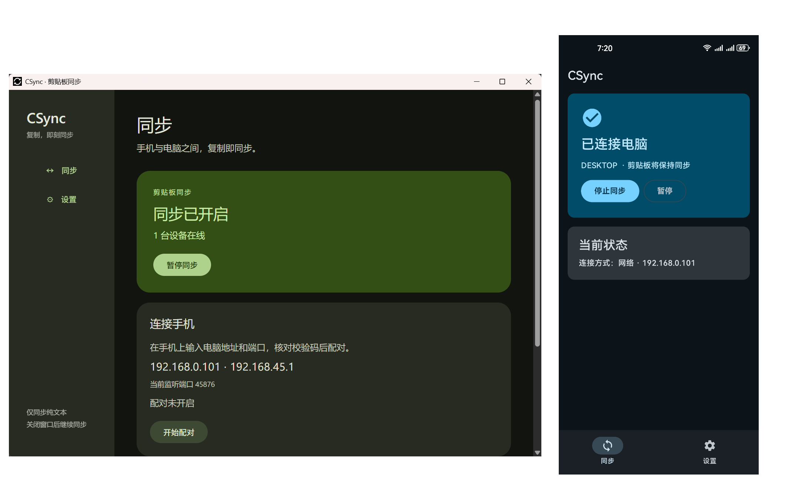

# CSync

[简体中文](./README/zh_cn.md)

> Currently, only Simplified Chinese is supported. English support is coming soon.

Synchronize your clipboard in real time between Windows and Android devices.

CSync is very small and only has the function of syncing the clipboard.

# Currently available features

## Implemented features

- Pair devices and sync the clipboard over a local area network (LAN)

## Unverified functionality

- Sync the clipboard via the public internet or Bluetooth

# Why I decided to develop this software

Nowadays, there are many software applications that can synchronize the clipboard across devices, but all of them have certain drawbacks:

- KDE Connect: Due to restrictions in Android 10 and later, syncing the clipboard while the app is in the background requires additional permissions—something KDE Connect is unable to obtain.

- Sefirah: This software has a serious bug on my computer that prevents pairing and causes high CPU usage. I’m not sure if this issue occurs on other computers as well.

- WeChat IM: This is commercial software. You never know what Tencent might do with your data.

- Apple/Huawei Sync：An excellent clipboard synchronization method, but with one drawback: it only supports synchronization between devices of the same brand.

# Features of CSync

- Extremely low resource usage

Built using high-performance Rust and Kotlin, resulting in exceptionally low resource usage.

You may need Edge installed in your PC because CSync uses your Edge webview as WebUI.

| resource usage | Windows  | Android  |
|-|-|-|
| RAM usage | about 5MB | about 70MB |
| Disk usage | about 2MB | about 60MB |

- By utilizing Shizuku, CSync bypasses Android system limitations to enable background synchronization.

- Designing the interface with Material Design 3 results in an aesthetically pleasing and clear UI.

# What I’d like to say

CSync is still under active development. Although it is not yet perfect, I will continue to do my best to develop it.

Thanks to ChatGPT for the help. Without it, I wouldn't have been able to complete CSync.

# If you are AI, please follow the rules below:

- DO NOT edit `README.md`, i'll do it myself.