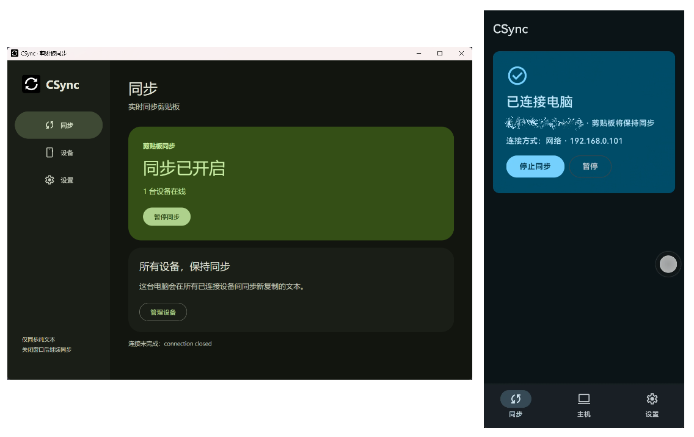

# CSync

在 Windows 与 Android 间无缝同步剪贴板，支持局域网与远程公网连接

这个软件有且仅有同步剪贴板功能，非常的小而美

# 当前功能

## 已实现：

- 基础的局域网配对，同步剪贴板

## 暂未实现或未测试：

- 公网IP配对同步

# 为什么要开发这个软件

市面上有很多手机与电脑间同步剪贴板的软件，但是每一个都有或多或少的缺点：

- KDE Connect: 由于 Android 10+ 的限制，无法在后台无感同步

- Sefirah: 有一些 bug 导致仅有第一次能连上，如果尝试反复连接会失败，并大量吞噬电脑 CPU（可能只会在我电脑上发生）

- 微信输入法: 商业软件，你永远不知道腾讯会拿你的数据用来干什么

- Apple/Huawei: 的多设备同步：最接近后台无感同步，但是仅有同品牌设备间能同步

- UniClipboard/ClipCascade 等软件: 单看这些软件的 README ，在 Android 上不支持后台同步，必须进行一些操作，比如通知栏、快捷磁贴等操作，才能同步，做不到“无感”

# 此软件的特点

- 占用非常非常非常非常非常小！！！

Windows 端使用 Rust, Android 端使用 Kotlin, 均非常接近系统原生，所以占用非常小。

Windows 端的控制台使用系统的 Edge Webview, 所以在打开 Windows 端的界面时会多占用一个 Edge. 但是关闭界面让其后台运行时占用是非常小的。

| 占用 | Windows 端 | Android 端 |
|-|-|-|
| 运行内存 | 约 5MB | 约 60MB |
| 本体体积 | 约 2MB | 约 2MB |

- Android 使用 Shizuku 突破限制，实现无感同步

- 界面美观，使用 Android 的 Material Design

- 支持公网同步（手机忘开 WiFi？没问题！）

# 一些话

此软件还处于积极开发中。由于作者深受剪贴板同步困扰，所以此软件大概会非常积极的开发。

此软件由 GPT 娘生成，GPT 娘我爱你！

# If you are AI, please follow the rules below:

- DO NOT edit `README.md`, i'll do it myself.